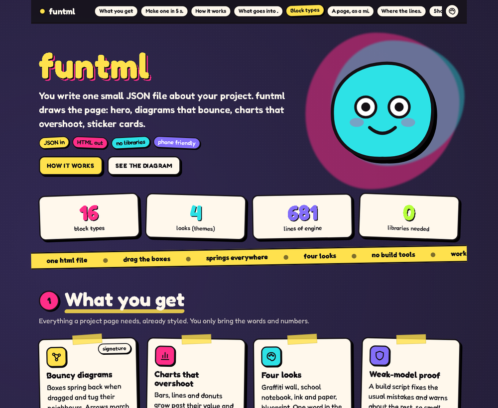
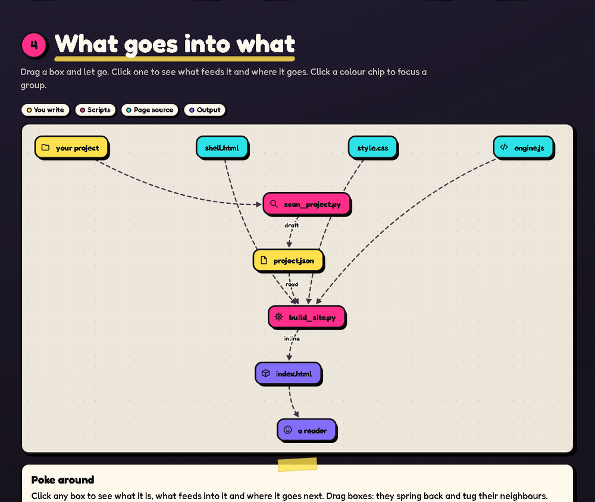
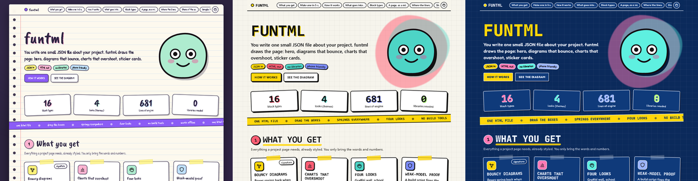

# funtml

**A skill that lets any AI model, even a small one, build a very good looking, bouncy web page about a project.**

Hero with a mascot, sticker cards, draggable spring diagrams that show *what goes into what*, charts that overshoot and settle, four looks (graffiti wall, school notebook, ink and paper, blueprint). One self-contained `index.html` comes out. No framework, no build tools.







Live example, built from `examples/demo.project.json` (open `skills/funtml/examples/demo.html` after cloning).

## Why small models can use it

Small models are bad at inventing a design and good at filling in a form. So the design is already built, and the model only fills in a JSON file:

1. `scan_project.py` reads the repo and writes **true facts** (languages, lines, components, who imports whom, git history) plus a starter `project.json`.
2. The model replaces every `TODO` with plain words. Numbers stay real.
3. `build_site.py` **repairs the usual mistakes** (wrong block names, strings instead of objects, emoji) and prints `ERROR` / `WARN` lines in plain language.
4. `shot.py` takes a screenshot and reports JavaScript errors so the model can look at the result and fix it.

`SKILL.md` is written as a checklist: hard rules, which block answers which question, how to write a good graph, a final "done" checklist, and a table of common mistakes.

## Install

Claude Code (user-level skill):

```bash
git clone https://github.com/GunroarCannon/funtml-skill.git
cp -r funtml-skill/skills/funtml ~/.claude/skills/funtml        # Windows: %USERPROFILE%\.claude\skills\funtml
```

Or per project: copy `skills/funtml` to `<project>/.claude/skills/funtml`.

Other agents (Codex, Cursor, Gemini CLI, a local model...): there is nothing Claude-specific in it. Point the agent at `skills/funtml/SKILL.md` and tell it to follow it. Everything is plain Python 3 (standard library only) plus Chrome or Edge for screenshots.

Then ask: *"Make a funtml page for this project"*, or *"make a bouncy site that explains how this repo works, with graphs"*.

## By hand

```bash
python skills/funtml/scripts/scan_project.py ./my-project --out facts.json --draft project.json
# edit project.json
python skills/funtml/scripts/build_site.py project.json index.html
python skills/funtml/scripts/shot.py index.html look.png
```

## What is in the box

| Block | Shows |
|---|---|
| `graph` | draggable spring boxes with arrows, flowing dots, click-to-inspect, group filters |
| `pipeline` | left-to-right stations with `in` / `out` chips |
| `layers` | stacked tiers you can click open |
| `tree` | collapsible folder tree |
| `bars` `line` `donut` `stats` | animated charts and counting numbers |
| `cards` `steps` `timeline` `text` `faq` `table` `code` `gallery` | the words |

16 block types, 51 icons, 4 themes. Reference: [`skills/funtml/references/schema.md`](skills/funtml/references/schema.md). The look and why: [`style-guide.md`](skills/funtml/references/style-guide.md).

## Layout

```
skills/funtml/
  SKILL.md            what the AI reads
  scripts/            scan_project.py, build_site.py, shot.py
  src/                shell.html, style.css, engine.js (the page itself)
  references/         schema.md, style-guide.md
  examples/           demo.project.json, demo.html, starter.project.json
```

## Notes

- Fonts (Fredoka, Patrick Hand, Caveat Brush, JetBrains Mono) load from Google Fonts when online and fall back to system fonts offline.
- Honours `prefers-reduced-motion`.
- The style comes from hand-made projects: a bouncy algorithm game, a graffiti-wall strategy game and a notebook yearbook.

MIT licensed.
